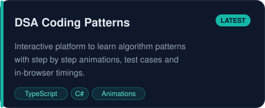
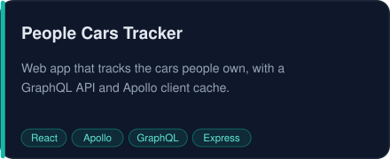
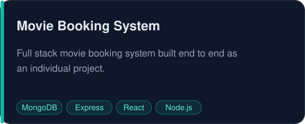
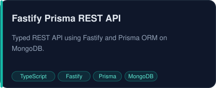
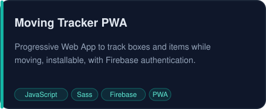
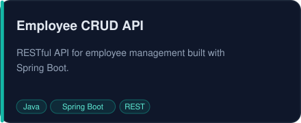

<!-- Banner -->

  <picture></picture>

  
  <picture></picture>
  <picture></picture>

 

<picture></picture>

I'm a software engineer with **13+ years** of experience across airline, telecommunications and enterprise software. Today I build a real time enterprise messaging platform using React, Redux and **Sencha Ext JS** in a micro frontend architecture, plus C# / .NET Core services backed by SQL Server.

My background spans the whole stack: from component libraries in Storybook to enterprise integration with Apache Camel, and from REST API design to database work. I hold a **Master's degree in Software Architecture**, and I care about clean boundaries, maintainable code and products that scale with the teams behind them.

 

<picture></picture>

<table>
  <tr>
    <td width="150"><b>Frontend</b></td>
    <td><picture></picture></td>
  </tr>
  <tr>
    <td><b>Backend</b></td>
    <td><picture></picture></td>
  </tr>
  <tr>
    <td><b>Data</b></td>
    <td><picture></picture>&nbsp;<picture></picture></td>
  </tr>
  <tr>
    <td><b>Cloud & Tools</b></td>
    <td><picture></picture></td>
  </tr>
</table>

  <picture></picture>
  <picture></picture>
  <picture></picture>
  <picture></picture>
  <picture></picture>
  <picture></picture>
  <picture></picture>

 

<picture></picture>

  
  
  
  
  
  

 

<picture></picture>

| | |
|:--:|:--|
| 🏆 | Part of the team whose **Enterprise Service Bus** (Apache Camel, Red Hat JBoss Fuse) at Avianca won Red Hat's **Innovation of the Year** award |
| 💳 | Integrated payment gateways and an anti fraud module into Avianca's website as part of a team of 4, contributing to a **35% increase** in online ticket sales |
| ⚡ | Building a high performance, real time **enterprise messaging** app with React and Redux in a micro frontend architecture |
| 🧩 | Maintaining a reusable **Storybook component library** that speeds up new views and keeps the product visually consistent |
| 🎓 | Helped coach **50 IT employees** on Scrum as part of a team of 6 |

  <picture></picture>
  <picture></picture>
  <picture></picture>

 

<picture></picture>

I'm open to conversations about **Software Engineer II / Senior** roles, especially in SaaS and CRM products for the non profit space. The best way to reach me is on [LinkedIn](https://www.linkedin.com/in/jharteaga/).

